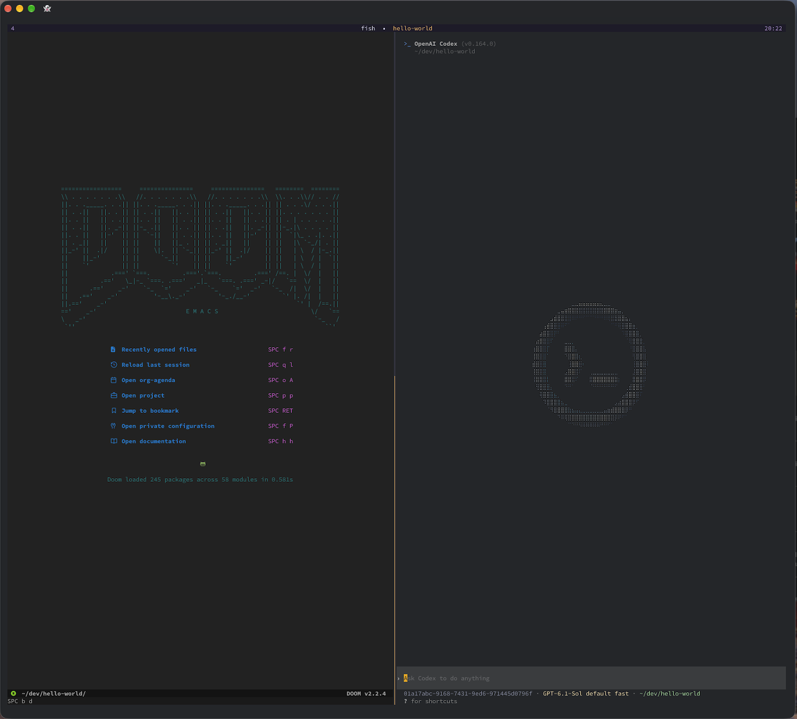

# spacedoom



Originally my Spacemacs-inspired Doom Emacs configuration; now my complete
terminal-first macOS setup: Doom Emacs with Evil and a Spacemacs Dark theme,
Fish, Ghostty, tmux and AeroSpace. This is the configuration I use, including
some old Linux aliases and project helpers that are useful mainly to me.

The interesting parts:

- `cdev PROJECT` opens or reuses a tmux window with Doom on the left and Codex
  on the right. Project-specific UUID pins prevent resuming another repository's
  conversation. One persistent Doom process keeps buffers across terminal clients.
- Codex activity travels through trusted lifecycle hooks into a cached tmux
  overlay: crimson working shimmer, white stopped dot, and a red pending approval.
  `Ctrl+F n` visits attention-required agents; `Ctrl+F a` acknowledges a stopped turn.
- `cnew NAME` creates a small personal Git repository. Existing projects and
  upstream instruction files are left alone.
- Doom's `SPC y` copies an Evil visual selection to the macOS clipboard. Project
  frames keep independent `SPC f f` roots. The dashboard has a uniform charcoal
  background and the original cyan artwork.

## Configuration

| Application | Source |
|---|---|
| Doom: modules, packages, Org, Lisp, snippets and templates | [configs/doom](configs/doom) |
| Fish: startup, functions, fzf integration and utilities | [configs/fish](configs/fish) |
| Ghostty: fonts, colors and Command-key forwarding | [configs/ghostty](configs/ghostty) |
| tmux: theme settings, navigation, popup and activity renderer | [configs/tmux](configs/tmux) |
| AeroSpace: tiling, gaps and workspace keys | [configs/aerospace](configs/aerospace) |
| Starship: built-in defaults | [configs/starship](configs/starship) |
| Codex instructions, hooks reference and cdev/session helpers | [configs/codex](configs/codex), [configs/cdev](configs/cdev) |
| Git, login shell, GitHub CLI and workmux preferences | [configs/git](configs/git), [configs/shell](configs/shell), [configs/gh](configs/gh), [configs/workmux](configs/workmux) |
| Named Doom server LaunchAgent | [configs/launchd](configs/launchd) |

[Install and adapt](docs/INSTALL.md) lists prerequisites and the actual commands.
[Inventory](docs/INVENTORY.md) accounts for each live path and intentional exclusion.
[Project workflow](docs/PROJECTS.md) explains new and upstream repositories.
[Lifecycle evidence and limits](docs/ACTIVITY.md) describes the Codex overlay.

## Releases, not development symlinks

```text
~/dev/dotfiles/configs/                 edit and commit
        | explicit validated copy
~/.local/share/dotfiles-active/releases/ID/
~/.local/share/dotfiles-active/current  atomic pointer
        | exact file symlinks
~/.config/doom/config.el, ~/.tmux.conf, ...
```

Editing this checkout never changes the running workstation. The small Python
release tool stages complete copies, validates them, backs up originals before
migration, and switches one pointer. It never reloads an application or installs
a service. [Workflow and rollback](docs/WORKFLOW.md), [Terminal.app recovery](docs/RECOVERY.md).

The full setup targets Apple Silicon and `/opt/homebrew`. It was tested on macOS
27 with Emacs 31.1, Fish 4.9.3, tmux 3.8 and Codex 0.164.0. It is not a portable
Linux installer or a promise that arbitrary newer Codex/Doom versions work.
Credentials, private identity, Org documents, sessions, pins and caches stay out
of Git. Collie is an external installation; this repository contains only its
optional cdev handoff, and no phone notification transport.

## Checks

```sh
python3.12 scripts/test.py
python3.12 scripts/test.py --integration
python3.12 scripts/deploy.py check
python3.12 scripts/deploy.py plan
python3.12 scripts/publication_audit.py
```

Integration tests own their temporary homes, sockets and processes; they do not
use the production tmux server or credentials. Native Codex authentication and
hook trust remain manual; offline tests do not claim real event delivery.
[Current status](docs/STATUS.md) records what was actually deployed and accepted.

Original work is [MIT](LICENSE); [third-party notices](THIRD_PARTY.md) cover the
Fish-derived prompt, fzf snapshot and Doom/simpleclip portions.
